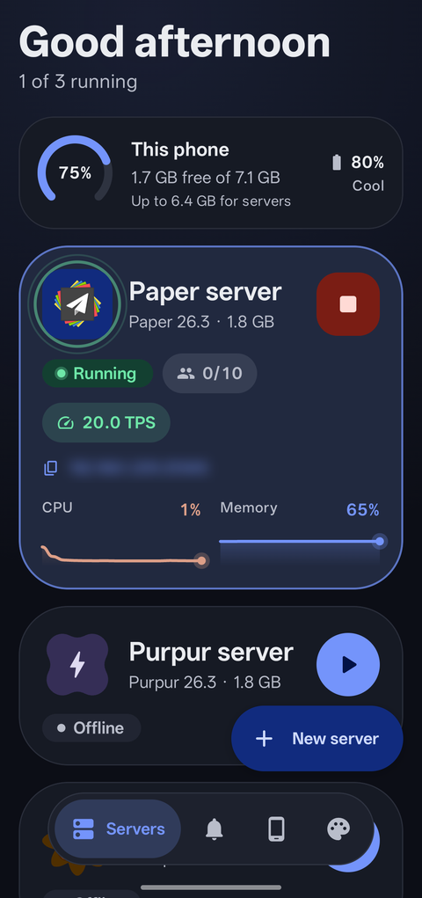
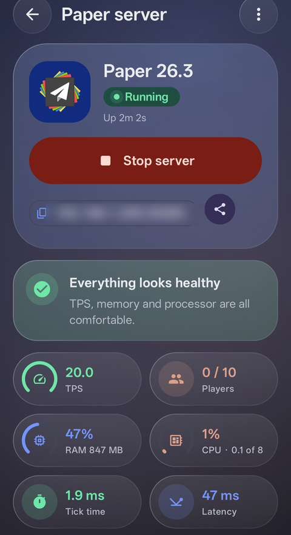
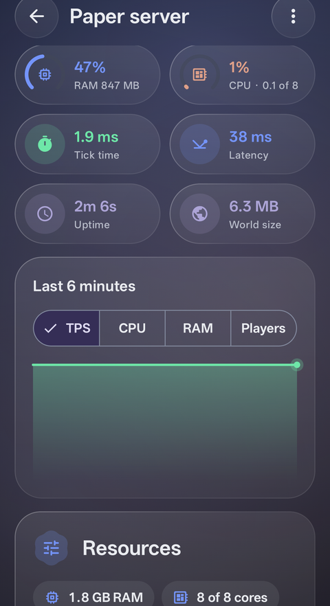
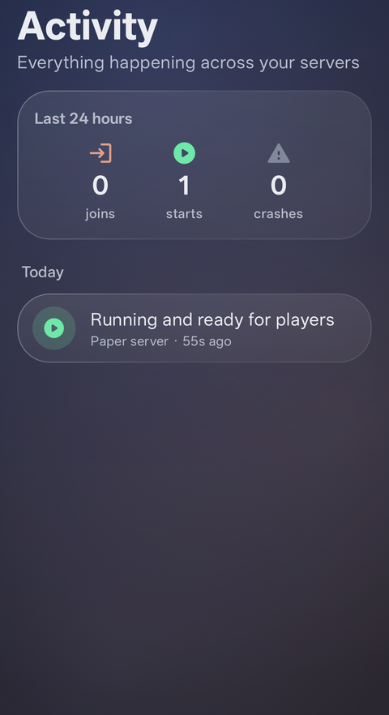
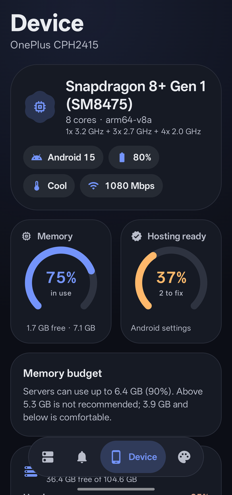
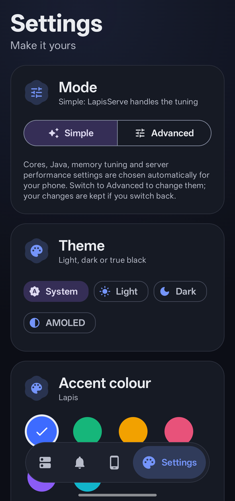
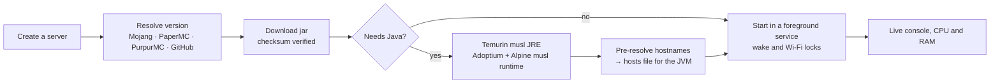

<div align="center">


# LapisServe

**Host Minecraft servers from your pocket.**
Material 3 Expressive · per-server resource controls · nothing bundled

[](../../releases)
[](../../actions/workflows/build.yml)
[](LICENSE)


[**Download**](../../releases/latest) · [Compatibility](docs/COMPATIBILITY.md) · [How it works](#-how-it-works) · [Build](#-build-from-source) · [Contribute](CONTRIBUTING.md)

<br/>

<table>
  <tr>
    <td></td>
    <td></td>
    <td></td>
  </tr>
  <tr>
    <td align="center"><sub>Every server at a glance</sub></td>
    <td align="center"><sub>TPS, players and plain-language health advice</sub></td>
    <td align="center"><sub>Live memory, CPU, tick time and latency</sub></td>
  </tr>
</table>

</div>

## ✨ Why LapisServe
Your phone has a fast ARM chip, plenty of RAM and a battery that doubles as a UPS. LapisServe turns it into a Minecraft server you can manage
from the same screen it runs on, with the knobs a real host expects and none of the setup.

| | |
| --- | --- |
| 🧩 **Four servers** | Vanilla, Paper, Purpur and Pumpkin (experimental, written in Rust) |
| ⬇️ **Nothing bundled** | Java, server jars, plugins and logos are downloaded from their official sources, with checksums verified |
| 📊 **Everything an owner watches** | **TPS** and tick time, players online and latency, memory and CPU against what's allocated, uptime, world size, 6-minute history charts |
| 💡 **Plain-language health advice** | "The server is lagging, lower the view distance from 8 to 6", "the phone is running hot", "battery is low" |
| 👥 **Players** | See who is online; kick, op, ban and whitelist in a tap |
| 🔔 **Activity feed and alerts** | Starts, stops, crashes and joins in one timeline; a notification if a server stops unexpectedly |
| 💾 **Backups** | One-tap world, whitelist, ops and ban backups with a safe restore |
| 🎚️ **Real resource control** | RAM up to 90% of the device, per-core pinning, scheduling priority, garbage collector, Java version, one-tap presets |
| 🛡️ **Device checkup** | Tells you which Android settings keep a server alive in the background, and shows your chip and core layout |
| 🔌 **Plugins** | Search, install and manage plugins from Modrinth, with required dependencies resolved (optional) |
| 🎨 **Make it yours** | Glass UI with an animated backdrop, six accent colours, light, dark and AMOLED themes, wallpaper colours, reduce-motion |

## 🧠 Smart about memory
The RAM slider knows your device. It caps at **90%** of physical memory, shifts from calm blue to amber to red as you approach unsafe values, shows
how much is in use right now, and warns you if what you ask for plus what Android is already using exceeds what's free.

<p align="center">
  
  &nbsp;&nbsp;
  
  &nbsp;&nbsp;
  
</p>

## 📲 Install
1. Download the latest APK from the [**Releases**](../../releases/latest) page. Each release includes a SHA-256 checksum.
2. Allow installing from your browser or file manager when Android asks.
3. Open LapisServe, go to the **Device** tab, and follow the suggestions. This is what decides whether your server survives with the screen off.
4. Tap **New server**, pick your software and version, and press **Start**. The first launch downloads what it needs.

> **Good to know:** you'll want an **ARM64 phone with at least 4 GB of RAM**. LapisServe isn't on the Play Store (see
> [why `targetSdk 28`](#-how-it-works)), so you install the APK yourself.


## 🧰 Supported software
| Server | What it's for | Plugins |
| --- | --- | :---: |
| **Vanilla** | The official Mojang server, unmodified | ✗ |
| **Paper** | High-performance fork with plugin support | ✓ |
| **Purpur** | Paper fork with extra gameplay options | ✓ |
| **Pumpkin** | Experimental server in Rust, tiny footprint, ARM64 only | ✗ |

## 🔧 How it works


- **Java on Android:** Android's libc can't run stock JVMs, so LapisServe downloads Eclipse Temurin for Linux/musl from Adoptium plus a small musl
  C runtime from Alpine's package repository, and starts the JVM through the musl loader.
- **DNS:** musl has no resolver configuration on Android, so the app resolves common hostnames itself and gives the JVM a hosts file
  (`-Djdk.net.hosts.file`, Java 9+). Add extra hostnames per server for plugins that call other sites.
- **Pumpkin config:** Pumpkin writes a full `pumpkin.toml` on first run; LapisServe lets it, then patches only the keys it manages (Java and Bedrock).
- **Why `targetSdk 28`:** Android 10+ stops apps targeting API 29 or higher from running files they downloaded. LapisServe has to run Java and
  Pumpkin, so, like Termux, it targets 28 and is distributed outside the Play Store.

## ⚠️ Known limitations
- **ARM64 only for servers.** Java servers run on real ARM64 phones. The x86_64 emulator can show the UI, but Android's seccomp filter kills musl
  binaries there, and the Android emulator can't run arm64 images on an x86 PC.
- Online-mode login relies on the pre-resolved hostname list; unusual hosts must be added in the server's network settings.
- Java 8 servers (Minecraft 1.16 and older) aren't supported by the DNS workaround.
- Pumpkin is experimental upstream.
- Tested so far on a single device (Snapdragon 8+ Gen 1, Android 15). See the [compatibility page](docs/COMPATIBILITY.md) and send a [device report](../../issues/new?template=device_report.yml).

## 🛠️ Build from source
Requires JDK 17+ (21 recommended) and the Android SDK (API 36).

```bash
./gradlew :app:assembleDebug        # APK in app/build/outputs/apk/debug
./gradlew :app:testDebugUnitTest    # unit tests
```

Release signing reads `keystore.properties` (git-ignored) or the `LAPIS_KEYSTORE_*` environment variables. Without them, release builds fall back
to the debug key so contributors can still build. Details in [CONTRIBUTING.md](CONTRIBUTING.md).

## 🔒 Privacy
No analytics, no telemetry, no account. LapisServe only contacts the sources listed in [NOTICE.md](NOTICE.md), when you create or start a server,
browse plugins, or the app fetches a project logo.

## 🤝 Contributing
Bug reports, device reports and pull requests are welcome. Start with [CONTRIBUTING.md](CONTRIBUTING.md). For security issues, see
[SECURITY.md](SECURITY.md).

## 📄 License and trademarks
LapisServe is licensed under the [Apache License 2.0](LICENSE). It is an independent project and is **not affiliated with or endorsed by** Mojang,
Microsoft, PaperMC, PurpurMC, the Pumpkin project or Modrinth. "Minecraft" is a trademark of Mojang Synergies AB. Third-party content, logos and
trademarks are covered in [NOTICE.md](NOTICE.md).
